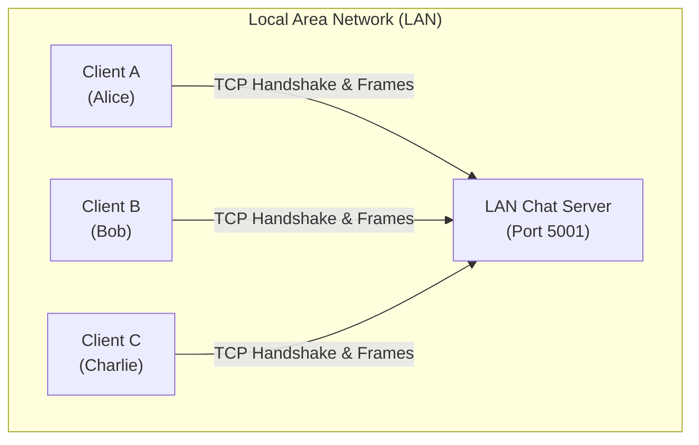
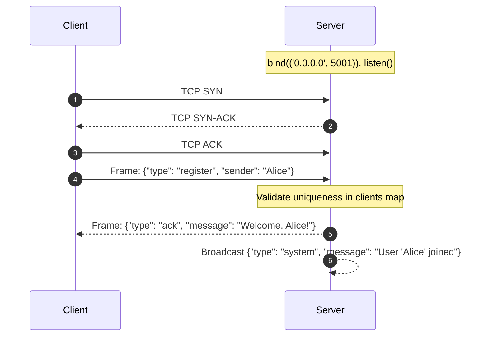
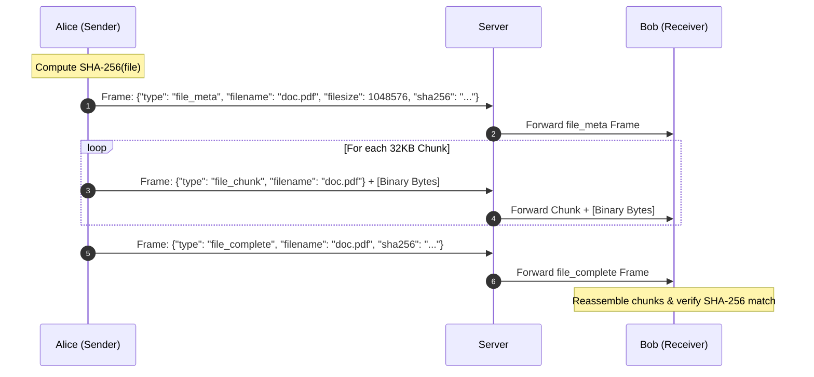

# Project 01: LAN Chat and File Sharing — Architecture

## 1. Architectural Overview

Project 01 implements a multi-threaded, connection-oriented client-server communication system over TCP/IP. It allows multiple heterogeneous client nodes situated on a Local Area Network (LAN) to exchange text messages (broadcast and unicast) and transfer binary files of arbitrary size with end-to-end cryptographic checksum verification.

---

## 2. Core Components

1. **`app/server.py` (`ChatServer`):**
   - Creates a master listening socket (`socket.AF_INET`, `socket.SOCK_STREAM`).
   - Uses `SO_REUSEADDR` to prevent port binding locks after restart.
   - Listens on `0.0.0.0` to accept connections across physical LAN network adapters.
   - Spawns an isolated background daemon worker thread for every connected client (`_handle_client`).
   - Maintains a thread-synchronized dictionary mapping `username -> (socket, address)`.
   - Routes broadcast frames to all connected sockets and private frames to target sockets.

2. **`app/client.py` (`ChatClient`):**
   - Connects to the server's LAN IP and assigned port.
   - Registers a unique username during the initial handshake.
   - Spawns a background listener thread (`_listen_loop`) that continuously parses incoming network frames without blocking user CLI input.
   - Streams outbound files in discrete 32 KB blocks to prevent buffer exhaustion.

3. **`app/protocol.py` (Framing Engine):**
   - Solves the fundamental TCP "stream without boundaries" problem.
   - Encodes a 4-byte big-endian length prefix (`!I`) specifying the length of a JSON control header, followed by a 4-byte binary payload length prefix, followed by the optional binary payload.
   - Uses an exact-byte receiver (`recv_exact`) to reassemble fragmented TCP segments reliably.

---

## 3. Communication Sequence

### Client Connection and Registration

### File Streaming Sequence

---

## 4. Error Handling and Edge Cases

- **Address In Use:** Trapped during `bind()` with clear guidance to wait for socket teardown or select an alternate port.
- **Premature Remote Disconnect:** `recv_exact()` raises `ConnectionError` on encountering zero-length reads, prompting the server to clean up client registries and alert peer clients.
- **Concurrent Dictionary Access:** Sychronized with a `threading.Lock()` to prevent race conditions during simultaneous user logins or logouts.
- **Transmission Integrity:** Reassembled files that fail SHA-256 verification are flagged as corrupted and not endorsed for execution.
