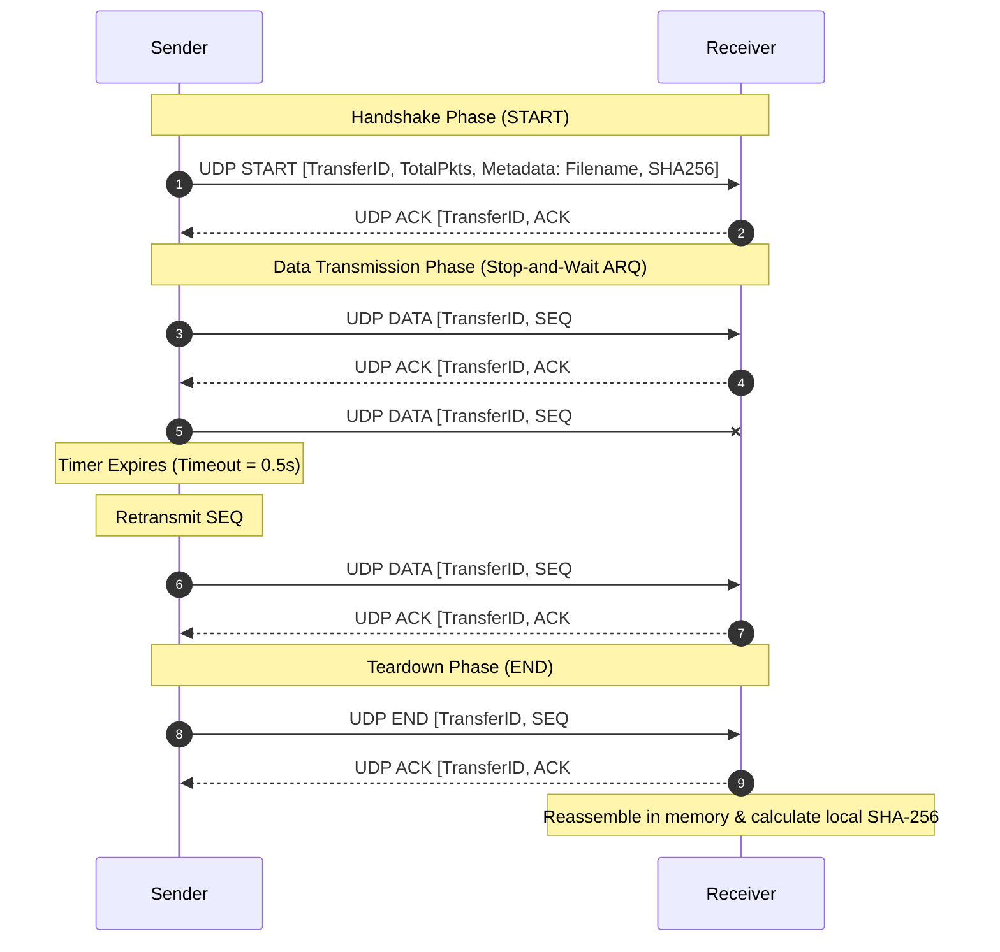

# Project 02: Reliable UDP File Transfer — Architecture

## 1. Architectural Overview

Project 02 implements a transport-layer reliability mechanism directly inside the application layer on top of User Datagram Protocol (UDP). UDP provides connectionless, best-effort packet delivery with zero guarantees regarding ordering, loss, or duplicate delivery. This architecture constructs an Automatic Repeat reQuest (ARQ) state machine featuring sequence numbering, explicit ACKs, dynamic timeouts, retransmissions, and bit-level CRC-32 integrity validation.

```mermaid
graph LR
    subgraph Sender["UDP Sender (Client)"]
        F[File on Disk] --> C[Chunking Engine]
        C --> P[Datagram Packaging + CRC-32]
        P --> ARQ[Stop-and-Wait ARQ State Machine]
    end

    subgraph Channel["Unreliable Network / Loss Channel"]
        ARQ -->|UDP Datagram: SEQ #n| D{Simulated Loss / Network}
        D -.->|Drop Packet (Loss)| X((Dropped))
        D -->|Deliver Packet| RECV[UDP Receiver]
    end

    subgraph Receiver["UDP Receiver (Server)"]
        RECV --> V{CRC-32 Valid?}
        V -->|Yes| S[Store Chunk & Emit ACK #n]
        V -->|No / Corrupted| DROP[Discard]
        S --> ACK_NET[UDP Datagram: ACK #n]
        ACK_NET --> ARQ
        S --> ASM[In-Order Reassembly]
        ASM --> HASH[SHA-256 Verification]
    end
```

---

## 2. Packet Wire Formats

The project defines binary-packed headers encoded using Python's `struct` in network byte order (Big-Endian `!`):

### Data / Control Packet Layout (17 Bytes Header)
```
 0                   1                   2                   3
 0 1 2 3 4 5 6 7 8 9 0 1 2 3 4 5 6 7 8 9 0 1 2 3 4 5 6 7 8 9 0 1
+-+-+-+-+-+-+-+-+-+-+-+-+-+-+-+-+-+-+-+-+-+-+-+-+-+-+-+-+-+-+-+-+
| Type (1 Byte) | Transfer ID (2 Bytes)         | Seq Num (4B)  |
+-+-+-+-+-+-+-+-+-+-+-+-+-+-+-+-+-+-+-+-+-+-+-+-+-+-+-+-+-+-+-+-+
| Seq Num (cont)| Total Packets (4 Bytes)                       |
+-+-+-+-+-+-+-+-+-+-+-+-+-+-+-+-+-+-+-+-+-+-+-+-+-+-+-+-+-+-+-+-+
| Total Pkts cnt| Payload Len (2 Bytes)         | CRC-32 Checksum
+-+-+-+-+-+-+-+-+-+-+-+-+-+-+-+-+-+-+-+-+-+-+-+-+-+-+-+-+-+-+-+-+
| CRC-32 (cont) | Payload Data (1 to 1400 Bytes)...             |
+-+-+-+-+-+-+-+-+-+-+-+-+-+-+-+-+-+-+-+-+-+-+-+-+-+-+-+-+-+-+-+-+
```

### Acknowledgment (ACK) Packet Layout (11 Bytes Header)
```
+-+-+-+-+-+-+-+-+-+-+-+-+-+-+-+-+-+-+-+-+-+-+-+-+-+-+-+-+-+-+-+-+
| Type (1B = 2) | Transfer ID (2 Bytes)         | ACK Seq Num(4B)
+-+-+-+-+-+-+-+-+-+-+-+-+-+-+-+-+-+-+-+-+-+-+-+-+-+-+-+-+-+-+-+-+
| ACK Seq (cont)| Status Code (4 Bytes: 0=OK, 1=CORRUPT)       |
+-+-+-+-+-+-+-+-+-+-+-+-+-+-+-+-+-+-+-+-+-+-+-+-+-+-+-+-+-+-+-+-+
```

---

## 3. Communication State Machine



---

## 4. Design Decisions & Trade-Offs

1. **Why Stop-and-Wait vs Sliding Window?**
   - For educational clarity and lab demonstrations, Stop-and-Wait ARQ provides clean, traceable retransmissions where students can observe individual packet timeouts on screen.
2. **Payload Size Bound (1024 - 1400 bytes):**
   - Standard Ethernet Maximum Transmission Unit (MTU) is 1500 bytes. Limiting UDP datagram payloads below 1400 bytes prevents IP-level packet fragmentation at intermediate routers, ensuring that packet loss corresponds directly to datagram loss.
3. **Dual Layer Checksumming:**
   - Transport layer (UDP) checksums are weak (16-bit 1's complement) and often disabled in local loops. We implement an explicit 32-bit CRC-32 on each datagram plus an end-to-end SHA-256 hash on the complete file.
