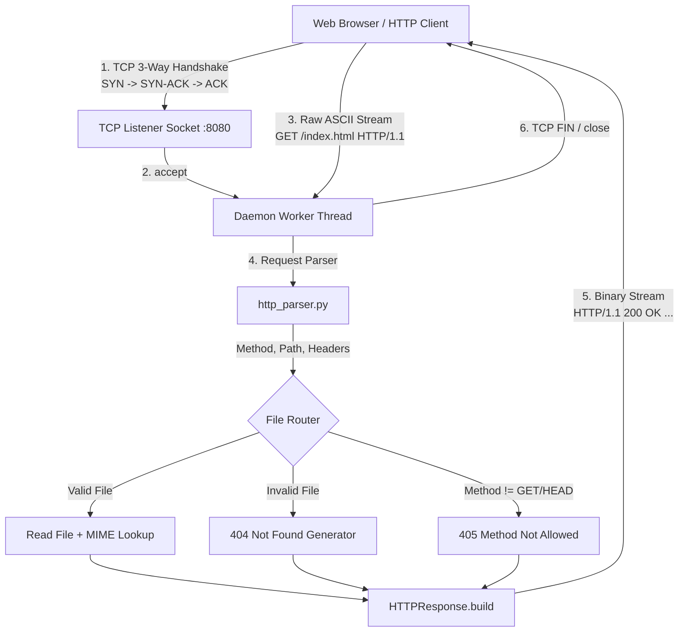
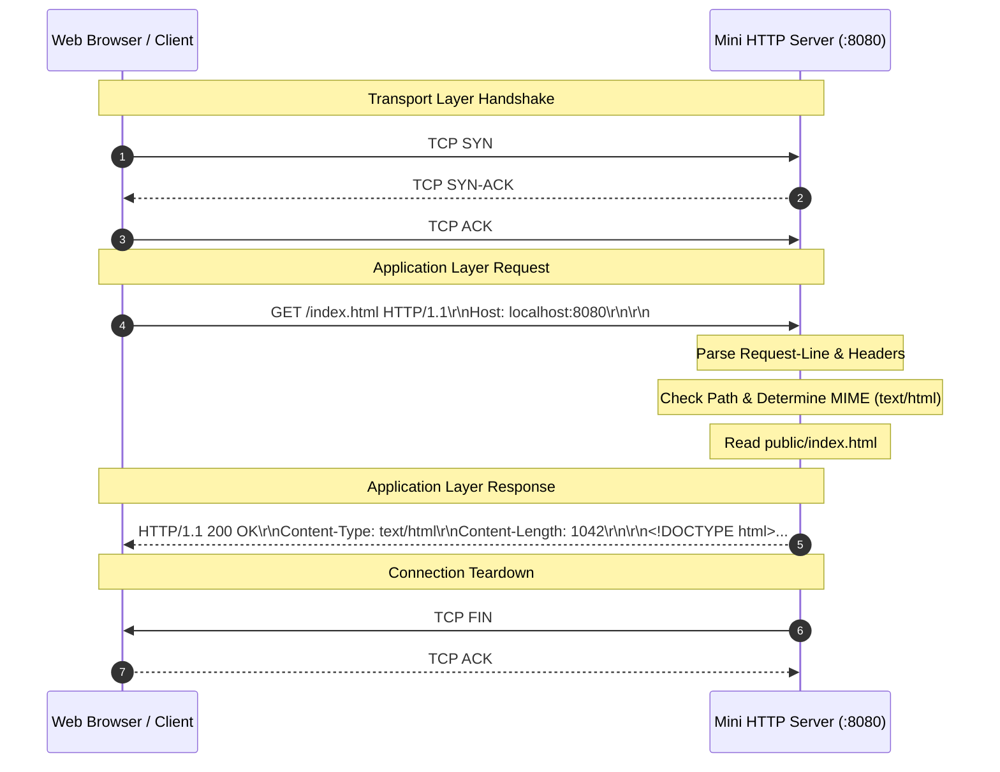

# Project 03: Mini HTTP Web Server — Architecture

## 1. Architectural Overview

Project 03 implements a standards-compliant Hypertext Transfer Protocol (HTTP/1.1 per RFC 2616 / RFC 7230) server and client from foundational primitives using low-level TCP stream sockets. It eliminates high-level framework wrappers (e.g. Flask, Django, FastAPI) in order to clearly expose the raw socket mechanics: accepting a connection, parsing ASCII text headers separated by Carriage Return Line Feeds (`\r\n`), resolving MIME types, and streaming binary HTTP responses.



---

## 2. Request and Response Framing

### HTTP/1.1 Request Wire Format
```
+-------------------------------------------------------+
| METHOD SP Request-URI SP HTTP-Version CRLF            |  <- Request Line
+-------------------------------------------------------+
| Header-Name: Header-Value CRLF                        |  <- Headers
| Header-Name: Header-Value CRLF                        |
+-------------------------------------------------------+
| CRLF (\r\n)                                           |  <- Empty line delimiter
+-------------------------------------------------------+
| Optional Request Body (e.g. POST data)                |  <- Body
+-------------------------------------------------------+
```

### HTTP/1.1 Response Wire Format
```
+-------------------------------------------------------+
| HTTP-Version SP Status-Code SP Reason-Phrase CRLF     |  <- Status Line
+-------------------------------------------------------+
| Server: MiniHTTPServer/1.0 CRLF                       |  <- Response Headers
| Date: Tue, 06 Oct 2026 04:00:00 GMT CRLF              |
| Content-Type: text/html; charset=utf-8 CRLF           |
| Content-Length: 1245 CRLF                             |
| Connection: close CRLF                                |
+-------------------------------------------------------+
| CRLF (\r\n)                                           |  <- Empty line delimiter
+-------------------------------------------------------+
| Response Body Stream (HTML, CSS, JSON, Binary Image)  |  <- Entity Body
+-------------------------------------------------------+
```

---

## 3. Communication Sequence



---

## 4. Security Considerations: Directory Traversal Protection

A critical vulnerability in hand-crafted HTTP servers is directory traversal (e.g., `GET /../../../../etc/passwd HTTP/1.1` or `GET /..%2f..%2fWindows/win.ini HTTP/1.1`).
This server implements strict path canonicalization:
```python
target_file = (self.public_dir / req_rel).resolve()
if not str(target_file).startswith(str(self.public_dir)):
    # Prohibit directory traversal with 403 Forbidden
```
Any request attempting to escape the designated `public/` directory root is immediately trapped and answered with `403 Forbidden`.
