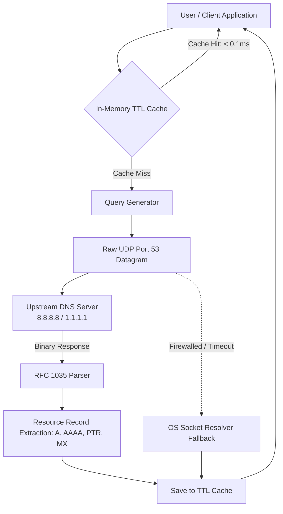
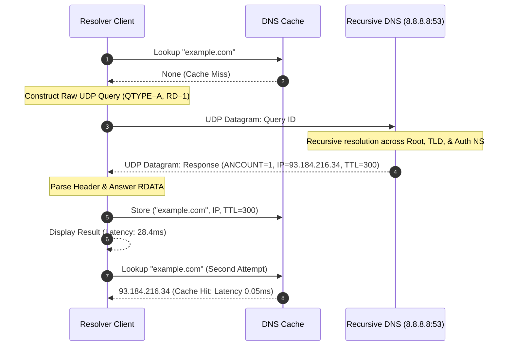

# Project 04: DNS Resolver and Domain Lookup — Architecture

## 1. Architectural Overview

Project 04 explores the Domain Name System (DNS, RFC 1035), the distributed hierarchical naming database of the Internet. The project implements a dual-mode lookup architecture:
1. **Low-Level Wire Protocol Engine (`app/dns_wire.py`):** Packs RFC 1035 binary questions into UDP datagrams sent to standard DNS port 53 (e.g. Google Public DNS `8.8.8.8`), extracting and decompressing Resource Records (A, AAAA, CNAME, MX, TXT).
2. **High-Level System Resolver & Cache Engine (`app/resolver.py`):** Provides fallback across local operating system resolution libraries (`socket.getaddrinfo`, `socket.gethostbyaddr`), measures end-to-end resolution latency in milliseconds, and caches entries using a thread-safe Time-To-Live (TTL) cache.



---

## 2. DNS Wire Protocol Anatomy (RFC 1035)

A DNS message over UDP port 53 comprises a 12-byte header followed by variable-length Question and Resource Record sections:

```
+-------------------------------------------------------+
| Query ID (16 bits)     | Flags & Control (16 bits)    |
+------------------------+------------------------------+
| QDCOUNT (16 bits)      | ANCOUNT (16 bits)            |
+------------------------+------------------------------+
| NSCOUNT (16 bits)      | ARCOUNT (16 bits)            |
+-------------------------------------------------------+
| Question Section (QNAME labels + QTYPE + QCLASS)       |
+-------------------------------------------------------+
| Answer Section (NAME + TYPE + CLASS + TTL + RDATA)     |
+-------------------------------------------------------+
```

### Label Encoding & Pointer Compression
- **Label Encoding:** Domain names are split by dots. Each label is preceded by an octet specifying its byte length:
  `google.com` $\rightarrow$ `\x06 g o o g l e \x03 c o m \x00`
- **Pointer Compression:** To conserve bandwidth, names repeated in Answer records refer back to prior offsets using a 2-byte pointer beginning with bit pattern `11` (`0xC0` mask):
  `0xC0 0x0C` refers to the domain name at byte offset 12.

---

## 3. Communication Sequence



---

## 4. Why UDP vs TCP for DNS

- **UDP Port 53 (Primary):** DNS queries are brief, single-request/single-response transactions. Establishing a TCP 3-way handshake (3 extra packets) would double lookup latency. UDP provides instantaneous datagram lookups.
- **TCP Port 53 (Secondary / Fallback):** TCP is invoked when:
  1. The response exceeds the traditional 512-byte UDP limit (TrunCation bit `TC=1` is set in header).
  2. DNS Zone Transfers (AXFR/IXFR) between authoritative servers require reliable streaming.
  3. DNSSEC records with large cryptographic keys exceed UDP buffer limits.
