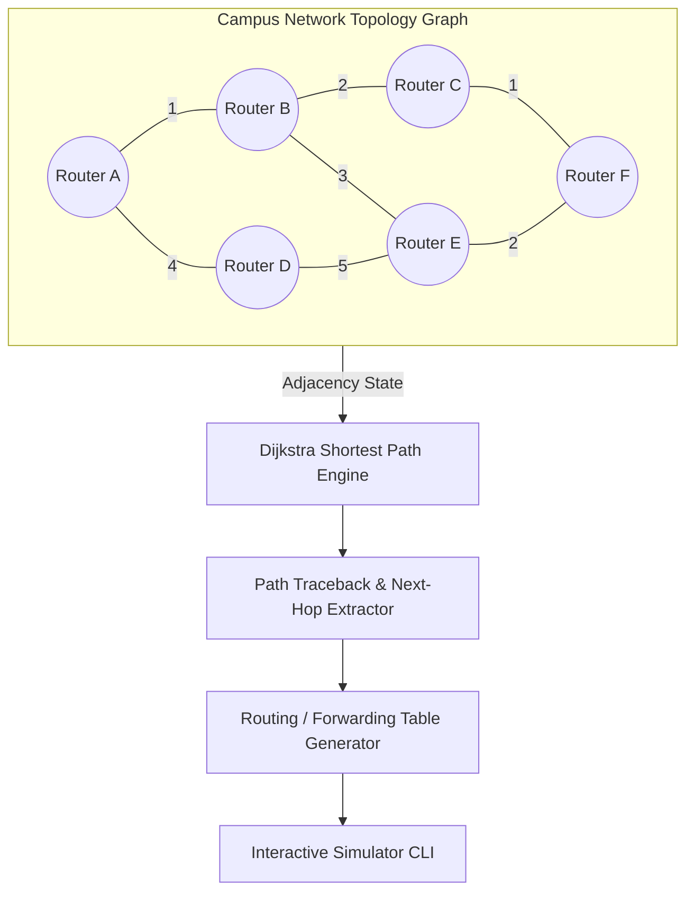

# Project 05: Network Routing Simulator — Architecture

## 1. Architectural Overview

Project 05 is an educational graph-theoretical routing simulation platform that models how intermediate Layer 3 (Network Layer) routers dynamically discover paths, construct forwarding tables, and adapt to network topology shifts or physical link failures.

The simulator contrasts the two dominant Interior Gateway Protocol (IGP) algorithmic families:
1. **Link-State Routing (OSPF):** Modeled using Dijkstra's Single-Source Shortest Path algorithm with a min-priority queue (`heapq`). Every router holds a global view of the topology graph.
2. **Distance-Vector Routing (RIP):** Modeled using the Bellman-Ford algorithm. Routers know only neighbor distances and vector costs.



---

## 2. Default Topology Graph Layout

```
      (Cost 1)             (Cost 2)
  [A] ----------- [B] ----------------- [C]
   |               |                     |
(4)|            (3)|                  (1)|
   |               |                     |
  [D] ----------- [E] ----------------- [F]
      (Cost 5)             (Cost 2)
```

- **Initial Optimal Path ($A \rightarrow F$):**
  $A \rightarrow B \rightarrow C \rightarrow F$
  $$\text{Total Cost} = 1 + 2 + 1 = 4 \quad (\text{Next Hop} = B)$$

- **Simulated Link Failure Scenario (Link $C \leftrightarrow F$ fails):**
  When link $C \leftrightarrow F$ goes down, the Link-State advertisement propagates.
  The engine recalculates the shortest path:
  $A \rightarrow B \rightarrow E \rightarrow F$
  $$\text{Total Cost} = 1 + 3 + 2 = 6 \quad (\text{Next Hop} = B)$$

---

## 3. Dijkstra's Algorithm Complexity & Data Structure

- **Graph Model:** Adjacency mapping stored in `NetworkTopology.links` with state flag `active: bool`.
- **Priority Queue:** Built on Python's binary min-heap `heapq`.
- **Time Complexity:** $O((V + E) \log V)$ where $V$ is the number of routers and $E$ is the number of links.
- **Space Complexity:** $O(V + E)$ for distance maps and predecessor traceback trees.

---

## 4. Link-State vs Distance-Vector Comparison

| Dimension | Link-State (Dijkstra / OSPF) | Distance-Vector (Bellman-Ford / RIP) |
|---|---|---|
| **Topology Knowledge** | Global: Every router knows complete network map | Local: Routers know only direct neighbor costs |
| **Routing Metric** | Configurable link cost (bandwidth / delay) | Hop count (limited to 15 in RIP) |
| **Convergence Speed** | Fast convergence upon link state changes | Slower convergence (susceptible to count-to-infinity) |
| **Computational Overhead** | Higher (runs Dijkstra locally per node) | Lower (simple vector addition with neighbors) |
| **Loop Freedom** | Guaranteed loop-free | Requires Split Horizon / Poison Reverse |
