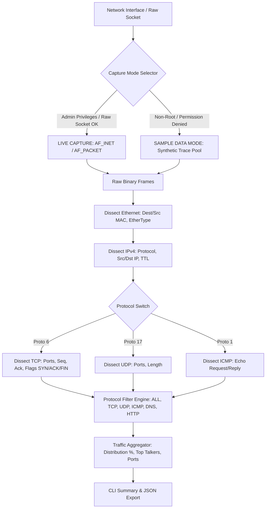

# Project 06: Packet Sniffer & Network Analyzer — Architecture

## 1. Architectural Overview

Project 06 implements a network packet capture, decapsulation, and statistical traffic analysis tool. It processes packets across multiple OSI layers:
- **Layer 2 (Data Link):** Ethernet II frame headers (MAC addresses, EtherType).
- **Layer 3 (Network):** IPv4 headers (version, IHL, Total Length, TTL, Protocol, Source IP, Destination IP).
- **Layer 4 (Transport):** TCP (ports, sequence, ACK, flags), UDP (ports, datagram length), and ICMP (types, codes).
- **Layer 7 (Application Hints):** Port-based heuristics identifying DNS (port 53), HTTP (ports 80/8080), and Ping Echo requests.



---

## 2. Low-Level Packet Decapsulation Anatomy

### IPv4 Header Layout (RFC 791)
```
 0                   1                   2                   3
 0 1 2 3 4 5 6 7 8 9 0 1 2 3 4 5 6 7 8 9 0 1 2 3 4 5 6 7 8 9 0 1
+-+-+-+-+-+-+-+-+-+-+-+-+-+-+-+-+-+-+-+-+-+-+-+-+-+-+-+-+-+-+-+-+
|Version|  IHL  |Type of Service|          Total Length         |
+-+-+-+-+-+-+-+-+-+-+-+-+-+-+-+-+-+-+-+-+-+-+-+-+-+-+-+-+-+-+-+-+
|         Identification        |Flags|      Fragment Offset    |
+-+-+-+-+-+-+-+-+-+-+-+-+-+-+-+-+-+-+-+-+-+-+-+-+-+-+-+-+-+-+-+-+
|  Time to Live |    Protocol   |        Header Checksum        |
+-+-+-+-+-+-+-+-+-+-+-+-+-+-+-+-+-+-+-+-+-+-+-+-+-+-+-+-+-+-+-+-+
|                       Source IP Address                       |
+-+-+-+-+-+-+-+-+-+-+-+-+-+-+-+-+-+-+-+-+-+-+-+-+-+-+-+-+-+-+-+-+
|                    Destination IP Address                     |
+-+-+-+-+-+-+-+-+-+-+-+-+-+-+-+-+-+-+-+-+-+-+-+-+-+-+-+-+-+-+-+-+
```
- Dissected with: `struct.unpack("!BBHHHBBH4s4s", raw_ip[:20])`

### TCP Header Layout (RFC 793)
```
 0                   1                   2                   3
 0 1 2 3 4 5 6 7 8 9 0 1 2 3 4 5 6 7 8 9 0 1 2 3 4 5 6 7 8 9 0 1
+-+-+-+-+-+-+-+-+-+-+-+-+-+-+-+-+-+-+-+-+-+-+-+-+-+-+-+-+-+-+-+-+
|          Source Port          |       Destination Port        |
+-+-+-+-+-+-+-+-+-+-+-+-+-+-+-+-+-+-+-+-+-+-+-+-+-+-+-+-+-+-+-+-+
|                        Sequence Number                        |
+-+-+-+-+-+-+-+-+-+-+-+-+-+-+-+-+-+-+-+-+-+-+-+-+-+-+-+-+-+-+-+-+
|                    Acknowledgment Number                      |
+-+-+-+-+-+-+-+-+-+-+-+-+-+-+-+-+-+-+-+-+-+-+-+-+-+-+-+-+-+-+-+-+
|  Data |           |U|A|P|R|S|F|                               |
| Offset| Reserved  |R|C|S|S|Y|I|            Window             |
|       |           |G|K|H|T|N|N|                               |
+-+-+-+-+-+-+-+-+-+-+-+-+-+-+-+-+-+-+-+-+-+-+-+-+-+-+-+-+-+-+-+-+
```
- Flags are decoded by bitmasking `flags_byte`:
  - `FIN = bool(flags_byte & 0x01)`
  - `SYN = bool(flags_byte & 0x02)`
  - `RST = bool(flags_byte & 0x04)`
  - `ACK = bool(flags_byte & 0x10)`

---

## 3. Safe Operating Mode Architecture

Raw socket creation requires elevated operating system privileges:
- On **Windows**: Requires Administrator rights and `SIO_RCVALL` ioctl.
- On **Linux**: Requires `root` or `CAP_NET_RAW` capability.

When running in standard lab accounts without administrative elevation, the sniffer intercepts the `PermissionError` and gracefully switches to **`SAMPLE DATA MODE`**. In this mode, genuine serialized binary packets representing real TCP handshakes, UDP DNS lookups, and ICMP pings are fed directly through the dissector and analysis pipeline, ensuring students can always execute and demonstrate the project regardless of user privilege level.
