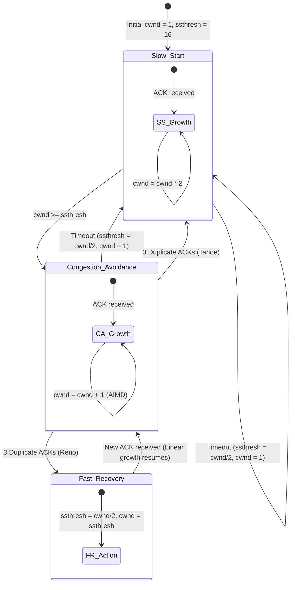

# Project 07: TCP Congestion Control Simulator — Architecture

## 1. Architectural Overview

Project 07 implements a discrete-event mathematical simulation of TCP congestion control algorithms (RFC 5681). Because kernel TCP congestion control involves operating system network buffer interactions that occur in microsecond intervals across physical internet links, directly visualizing transitions between Slow Start, Congestion Avoidance, Fast Retransmit, and Fast Recovery in a student lab requires an interactive simulation environment.

---

## 2. Mathematical State Model

### State 1: Slow Start
- **Condition:** $\text{cwnd} < \text{ssthresh}$
- **Action on ACK:** Exponential growth per transmission round:
  $$\text{cwnd}_{t+1} = \text{cwnd}_t \times 2$$

### State 2: Congestion Avoidance (AIMD)
- **Condition:** $\text{cwnd} \ge \text{ssthresh}$
- **Action on ACK:** Additive increase per transmission round:
  $$\text{cwnd}_{t+1} = \text{cwnd}_t + 1$$

### Loss Event A: Retransmission Timeout (Severe Congestion)
- Multiplicative Decrease:
  $$\text{ssthresh} \leftarrow \max\left(2, \left\lfloor\frac{\text{cwnd}}{2}\right\rfloor\right)$$
- Reset window:
  $$\text{cwnd} \leftarrow 1$$
- State: Transition to **Slow Start**.

### Loss Event B: Triple Duplicate ACKs (Mild Congestion / Segment Drop)
- Multiplicative Decrease:
  $$\text{ssthresh} \leftarrow \max\left(2, \left\lfloor\frac{\text{cwnd}}{2}\right\rfloor\right)$$
- **TCP Tahoe:**
  $$\text{cwnd} \leftarrow 1 \implies \text{Slow Start}$$
- **TCP Reno (Fast Recovery):**
  $$\text{cwnd} \leftarrow \text{ssthresh} \implies \text{Congestion Avoidance}$$

---

## 3. Terminal ASCII Plotter Design

The simulation features an ASCII canvas visualizer (`render_ascii_graph`) that normalizes rounds on the X-axis and dynamic `cwnd` values on the Y-axis. This enables direct visual demonstration of the classic "sawtooth" curve characteristic of Additive Increase, Multiplicative Decrease (AIMD) transport protocols.
