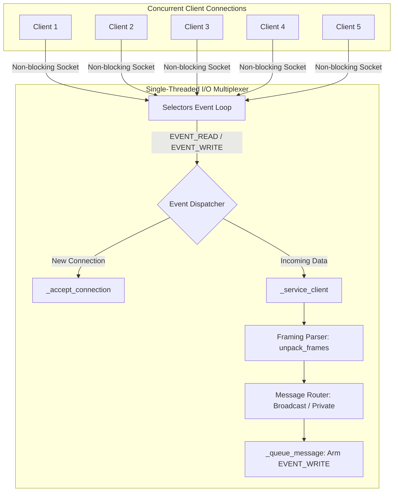

# Project 08: Multi-Client Network Server — Architecture

## 1. Architectural Overview

Project 08 explores high-concurrency server engineering on TCP/IP networks. In traditional synchronous socket servers, calling `recv()` or `accept()` blocks the operating system execution thread until data arrives from the client. Handling $N$ concurrent clients requires allocating $N$ threads, leading to severe operating system memory and context-switching overhead (the classic "C10K" problem).

This project implements an event-driven I/O multiplexing architecture using the Python `selectors` module (`epoll` on Linux, `kqueue` on macOS/BSD, `select` on Windows). A single execution thread monitors dozens or hundreds of non-blocking sockets simultaneously, executing callbacks only when a socket is genuinely ready to read (`EVENT_READ`) or write (`EVENT_WRITE`).

---

## 2. Concurrency Model Comparison

| Metric | Thread-Per-Client (Project 01) | I/O Multiplexing (Project 08) |
|---|---|---|
| **OS Threads** | $N$ threads for $N$ clients | Exactly 1 event-loop thread |
| **Memory Footprint** | High (~1-8MB stack per thread) | Extremely low (per-socket buffer objects only) |
| **Context Switching** | Expensive OS kernel context switching | Zero kernel thread switches; userspace event polling |
| **Socket Mode** | Blocking (`setblocking(True)`) | Non-blocking (`setblocking(False)`) |
| **Scalability Limit** | Hundreds of clients | Tens of thousands of clients (C10K compliant) |

---

## 3. Non-Blocking State Machine and Output Buffering

Because sockets are configured with `conn.setblocking(False)`, calling `send()` can write fewer bytes than requested if the TCP send buffer fills up (or return `EWOULDBLOCK`).
To prevent data loss or busy-waiting:
1. When data is ready to be sent to a client, it is appended to `session.out_buffer`.
2. The socket's selector mask is updated to `EVENT_READ | EVENT_WRITE`.
3. When the operating system signals that the socket's outbound buffer has capacity (`EVENT_WRITE`), the server flushes pending bytes from `session.out_buffer`.
4. As soon as `session.out_buffer` is empty, `EVENT_WRITE` interest is removed, leaving only `EVENT_READ` active to avoid CPU-churning busy loops.
