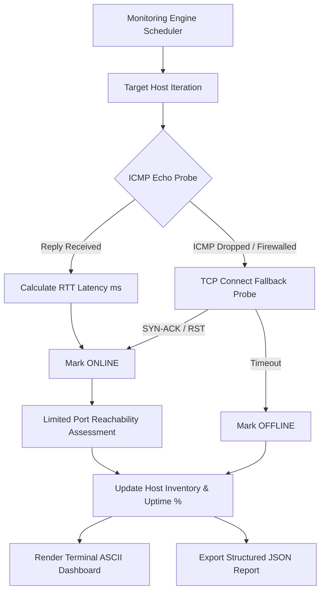

# Project 09: Network Monitoring & Device Discovery — Architecture

## 1. Architectural Overview

Project 09 is a local network health, device availability, and latency monitoring engine. It probes networked hosts using dual mechanisms:
1. **ICMP Echo Probes (Layer 3):** Dispatches native ICMP ping requests to calculate round-trip network transit latency (RTT) in milliseconds.
2. **TCP Connect Probes (Layer 4):** Measures service reachability across common ports (e.g. 80, 443, 8080, 5001, 5008). In firewalled environments where ICMP Echo is blocked by border routers or operating system firewalls, TCP connection probes serve as an effective reachability fallback.

---

## 2. Port State Mechanics

The TCP port probing engine distinguishes three primary network states:
- **`OPEN` (Active Listener):** The target system completes the TCP handshake (`SYN-ACK`), confirming an active server process listening on the port.
- **`CLOSED` (Connection Refused):** The target host is online and responds with a TCP `RST` (Reset) packet or raises `ConnectionRefusedError`, indicating no application is bound to the port.
- **`FILTERED / TIMEOUT`:** No response packet is received within the timeout window, indicating that a network packet filter or firewall dropped the packet silently.

---

## 3. High Availability Metric Formulation

The system tracks host reliability over time:
$$\text{Uptime Percentage} = \left( \frac{\text{Successful Checks}}{\text{Total Checks Conducted}} \right) \times 100\%$$

State transitions ($ONLINE \rightarrow OFFLINE$ or $OFFLINE \rightarrow ONLINE$) trigger alerts to capture intermittent link flapping or service outages.
