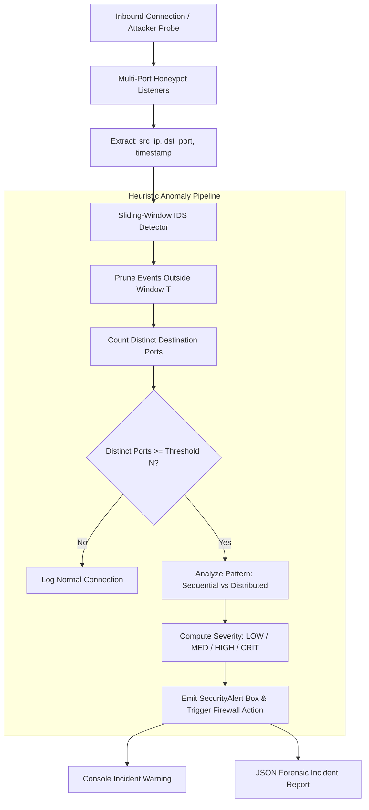

# Project 10: Network Intrusion & Port Scan Detection — Architecture

## 1. Architectural Overview

Project 10 implements a defensive Network Intrusion Detection System (NIDS) designed to identify adversarial reconnaissance patterns such as horizontal and sequential port scans.

Adversaries routinely execute port scans (e.g. using tools like Nmap or Masscan) to map open services, operating system versions, and vulnerable daemons before launching an exploit. This project constructs an anomaly-detection engine based on a sliding time-window heuristic, monitoring inbound TCP connection telemetry across honeypot listener sockets on the local interface (`127.0.0.1`).

---

## 2. Sliding-Window Heuristic Algorithm

Let $E(s, t)$ be the set of inbound connection attempts originating from source IP $s$ within current time $t$:
$$E(s, t) = \{ (p, \tau) \mid \tau \ge t - T \}$$
where:
- $T$ is the sliding time window duration in seconds (default: 10.0s).
- $N$ is the port threshold count (default: 5 distinct ports).

The set of distinct targeted destination ports is:
$$P(s, t) = \{ p \mid (p, \tau) \in E(s, t) \}$$

$$\text{Trigger Condition: } |P(s, t)| \ge N$$

---

## 3. Threat Classification & Severity Matrix

| Metric / Pattern | Reconnaissance Type | Severity | Recommended SOC Response |
|---|---|---|---|
| $|P| \ge 5$ random ports | Horizontal Distributed Sweep | `MEDIUM` | Rate-limit source IP |
| $|P| \ge 5$ sequential ports | Sequential Port Reconnaissance | `MEDIUM` | Flag IP in temporary quarantine |
| $|P| \ge 10$ distinct ports | Aggressive Service Discovery | `HIGH` | Block IP at host firewall (iptables / Windows Firewall) |
| $|P| \ge 20$ distinct ports | Full Spectrum Network Scan | `CRITICAL` | Block at enterprise perimeter border router |

---

## 4. Ethical Safeguards & Safety Boundaries

- **Local Host Scoping:** All honeypot listening sockets and simulation scripts are hardcoded by default to bind to `127.0.0.1` (`localhost`).
- **No External Packet Injection:** The companion simulator (`simulator.py`) strictly enforces loopback validation to prevent unauthorized probe transmissions against third-party networks.
- **Defensive Focus:** The software strictly performs detection, logging, and incident reporting without carrying weaponized counter-attack payloads.
