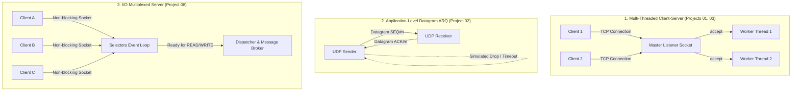
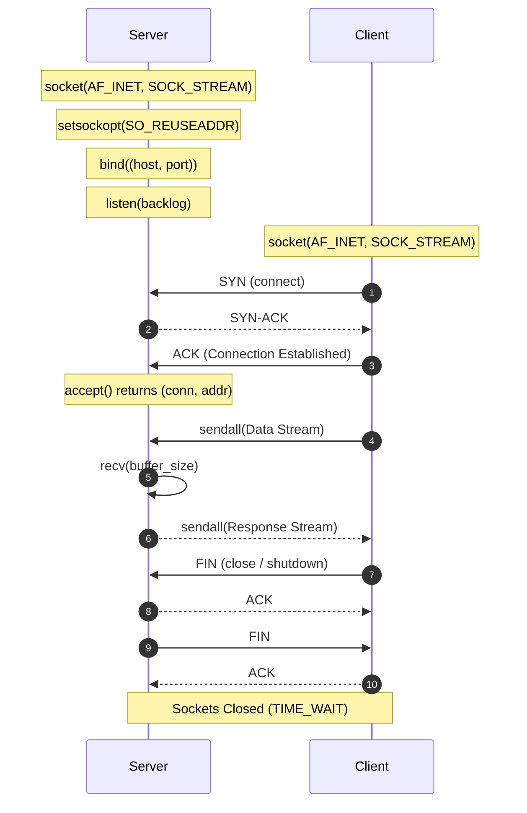
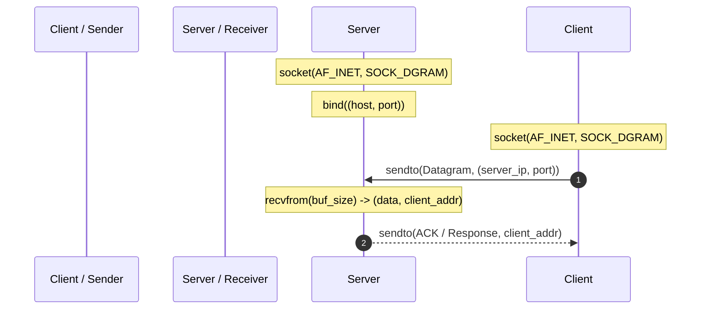

# Architecture Overview

This document presents the overarching architectural designs, concurrency patterns, and socket lifecycle models implemented across the 10 Computer Networks academic projects.

---

## 1. High-Level Architectural Models

Across the collection, three primary networking architectures are developed and contrasted:

---

## 2. Standard Socket Lifecycle

### TCP Socket State Machine (RFC 793)
Implemented in Projects 01, 03, 08, 09, 10:

### UDP Socket State Machine (RFC 768)
Implemented in Projects 02, 04:

---

## 3. Data Framing and Serialization Strategies

TCP provides an unstructured byte stream with no intrinsic record delimiters. A common pitfall in academic networking projects is assuming `recv(1024)` always yields exactly one complete message. Our projects employ explicit framing protocols:

1. **Length-Prefixed Framing (Project 01 & 08):**
   - Each frame begins with a fixed 4-byte big-endian unsigned integer (`struct.pack("!I", length)`) representing the byte length of the ensuing payload.
   - The receiver performs exact-length buffered reading until the expected payload is received in full.
2. **HTTP/1.1 Delimited Framing (Project 03):**
   - Uses `\r\n\r\n` (CRLF CRLF) delimiters to identify the termination of HTTP headers, followed by `Content-Length` bounded reads for message bodies.
3. **Structured Binary Datagram Framing (Project 02):**
   - Encodes a binary packet header using Python `struct` containing:
     - `Transfer_ID` (16-bit unsigned integer)
     - `Sequence_Number` (32-bit unsigned integer)
     - `Total_Packets` (32-bit unsigned integer)
     - `Payload_Length` (16-bit unsigned integer)
     - `Checksum` (32-bit CRC32 / Adler32 integer)
     - Variable-length raw binary payload (up to 1400 bytes, avoiding IP fragmentation).

---

## 4. Error Handling and Resilience Architecture

All projects implement structured exception hierarchies for network anomalies:

- `socket.error` / `OSError`: Trapped during `bind()` when a port is already bound, raising user-friendly warnings (`Address already in use`).
- `socket.timeout`: Trapped in non-blocking or timed socket operations to prevent indefinite deadlocks.
- `ConnectionResetError` / `BrokenPipeError`: Detected when a remote peer abruptly drops the connection, triggering resource cleanup without crashing the server.
- Context managers (`with socket.socket(...)`) and `finally:` blocks to guarantee socket descriptor deallocation.
